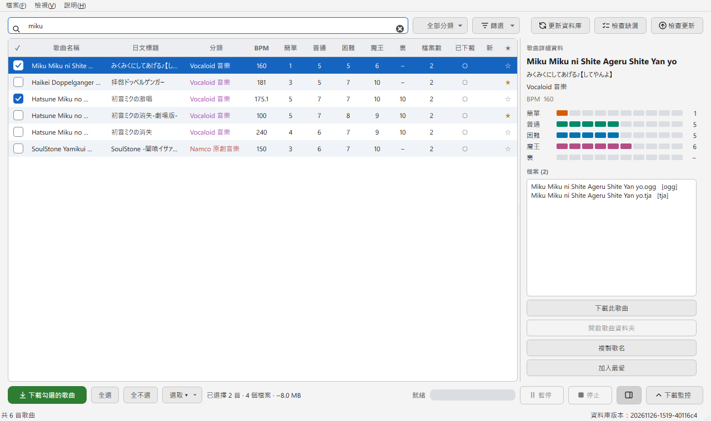
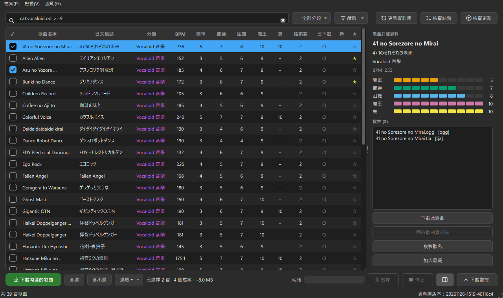

# ESEManager

從 **ESE（Every Song Ever）** 專案瀏覽與下載太鼓達人 TJA 譜面的高速桌面程式。

[English](README.md) | **繁體中文**



<details>
<summary>深色主題，搜尋框使用篩選語法 <code>cat:vocaloid oni:&gt;=9</code></summary>



</details>

## 功能

- 高速歌曲清單：上千首一次顯示、可依欄位排序、無需分頁
- 即打即搜（支援日文標題），可依分類篩選
- **依 BPM 區間與難度等級篩選**（簡單／普通／困難／魔王／裏）
- 批次下載，可**暫停／繼續／停止**，即時進度、失敗一鍵重試
- **檢查缺漏**與**檢查更新**：找出尚未下載的歌，或上游已更新的譜面（以 git blob 雜湊比對）
- 歌曲資料庫由 GitHub 每 6 小時從 ESE 自動重建；按「更新資料庫」即下載最新版，
  啟動時有新版也會詢問
- 下載會驗證（TLS、檔案大小、譜面的 git blob 雜湊），並先寫到 `.part` 檔，中斷也不會留下壞檔
- **鏡像站**：設定裡可選下載來源（ESE 官方或 [git.taiko.ac](https://git.taiko.ac/zdon/ESE) 鏡像），
  選的來源連不上、找不到檔案或內容不符時，會自動改用另一個
- 淺色／深色主題，介面語言自動偵測（English／繁體中文／日本語）
- 一鍵下載 [ESE-Version-Sorting](https://ese.tjadataba.se/Yonokid/ESE-Version-Sorting)（YataiDON 版本分類資料夾）
  到下載目錄：**檔案 → 下載版本分類**
- 命令列模式（`ESEManager-cli`），方便寫腳本或在伺服器上使用
- Rolling release，**自動更新**：有新版本時會在背景下載並驗證 SHA-256，關閉程式時自動換成新版
  （也可以按通知「立即重新啟動」）；設定、資料庫和下載的歌曲都保留。可在設定裡關閉，改回手動更新

## 快速開始

從 [Releases 頁面](https://github.com/GanYiZhong/ESEManager/releases/latest)下載對應平台的最新版，
解壓後執行 `ESEManager`（Windows 為 `ESEManager.exe`）。第一次啟動時程式會詢問是否下載歌曲資料庫，
之後即可搜尋與下載。

設定檔、資料庫和預設的 `Downloads` 資料夾都放在執行檔旁邊，更新時按狀態列的更新提示、執行 `ESEManager-cli self-update`，或手動把新版解壓覆蓋舊資料夾都可以。

Linux 若出現無法載入 Qt `xcb` 外掛的錯誤，請安裝 `libxcb-cursor0`（Debian/Ubuntu）或
`xcb-util-cursor`（Fedora/Arch）。

## 拖放與「開啟檔案」

- 把歌單（`.esesongs`、`.json`、`.txt`）或從聊天軟體複製的文字拖進視窗，等同「檔案 > 匯入」；拖曳時會顯示提示。
- 把資料夾拖進視窗會詢問是否設為下載資料夾；直接拖到資料夾欄位則立即設定。
- `ESEManager.exe path	o\list.esesongs` 會開啟程式並匯入歌單。要從檔案總管「開啟檔案」：對 `.esesongs` 按右鍵 > 開啟檔案 > 選擇其他應用程式 > ESEManager.exe（可勾選「一律使用」）。程式不會自動註冊檔案關聯。
- 匯出的歌單預設副檔名為 `.esesongs`（內容為 JSON），仍可使用 `.json` 與 `.txt`。

## 命令列模式

Release 版在主程式旁附有 `ESEManager-cli`（Windows 為 `ESEManager-cli.exe`）；從原始碼執行則用
`python src/cli.py`。與 GUI 共用同一份資料庫、設定與下載目錄。

```
ESEManager-cli status [--offline]          # 版本、資料夾、歌曲數
ESEManager-cli update-db                   # 下載最新歌曲資料庫
ESEManager-cli search 千本桜               # 也支援日文標題
ESEManager-cli download Senbonzakura -y    # 下載符合的歌
ESEManager-cli download --all -y           # 全部下載
ESEManager-cli missing --download -y       # 下載缺少的歌
ESEManager-cli updates --download -y       # 下載上游更新過的譜面
ESEManager-cli version-sorting             # 安裝／更新 ESE-Version-Sorting
ESEManager-cli self-update                 # 下載最新版 ESEManager 並覆蓋安裝
```

| 選項 | 適用指令 | 說明 |
|---|---|---|
| `--dir 資料夾` | 全部 | 下載目錄（預設讀 `config.toml`，否則為程式旁的 `Downloads`） |
| `--workers N` | download、missing、updates | 並行下載數 1–16，ESE 最多 3 條、其餘走鏡像（預設讀 `config.toml`，否則 3） |
| `--source S` | download、updates | 下載來源：`ese`、`taiko.ac` 或自訂網址（預設讀 `config.toml`，否則 `ese`；另一個自動當備援） |
| `--lang zh_TW\|en\|ja` | 全部 | 訊息語言 |
| `--json` | 全部 | stdout 每行輸出一個 JSON 物件，訊息改到 stderr |
| `-q`, `--quiet` | 全部 | 只輸出結果與錯誤；`search` 每行一個歌名 |
| `-c`, `--category 名稱` | search、download | 分類或分類名稱的一部分（`-c Anime`） |
| `--limit N` | search、missing、updates | 最多列出幾筆（預設 50，0＝全部） |
| `--all` | download | 下載全部歌曲 |
| `--download` | missing、updates | 直接下載找到的項目，而不是只列出 |
| `-y`, `--yes` | download、missing、updates、self-update | 不詢問確認 |
| `--force` | update-db、version-sorting | 已是最新也重新下載 |
| `--offline` | status | 不向 GitHub Pages 查詢最新資料庫版本 |
| `--check` | self-update | 只檢查有沒有新版本 |

終端機上會顯示進度條（百分比、速度、剩餘時間）並用顏色標示結果；設定環境變數 `NO_COLOR` 可關閉顏色，導向到檔案或管線時不會有顏色。`search` 結尾會提示下一步的 `download` 指令。

結束碼 0＝成功、1＝有失敗、2＝沒事可做或用法錯誤。沒有終端機時（腳本、排程）確認提示一律視為「否」，
請加上 `-y`。

```
ESEManager-cli search Senbonzakura --json | jq -r .song
```

## 從原始碼執行

需要 Python 3.9+（Windows、Linux；macOS 理論上可用但未測試）。

```
pip install -r requirements.txt
python src/ese_qt.py
```

從原始碼執行時，資料檔放在專案根目錄。`config.toml` 會在第一次執行時建立，可用的設定見
`config.toml.example`。`update_databases.bat`／`update_databases.sh` 會下載最新的預先建好資料庫
（等同 `cli.py update-db`）。警告與錯誤會寫進程式旁的 `ESEManager.log`。

## 測試

```
pip install -r requirements.txt -r requirements-test.txt
python -m pytest tests --cov=src
```

CI 會在 Windows 與 Linux 上跑測試，並要求最低覆蓋率。

## 打包成執行檔

```
pip install -r requirements-build.txt
pyinstaller --noconfirm --clean packaging/ESEManager.spec
python scripts/fetch_release_dbs.py dist/ESEManager   # 選用：一併放入目前的資料庫
```

輸出：`dist/ESEManager/` 資料夾（onedir），發佈時整個資料夾一起打包。

## 發佈方式（rolling release）

每次推送到 `main` 且有改到程式（`src/`、`packaging/`、`assets/`、requirements），
`.github/workflows/release.yml` 就會自動：

1. 跑測試、打包 Windows 與 Linux 版並做冒煙測試；
2. 以日期為版本號發佈 release：`v2026.11.18`，同一天第二版為 `v2026.11.18.2`（台北時間），
   release notes 為這次的 commit 清單，附上
   `ESEManager_<版本>_windows-x86_64.zip`、`ESEManager_<版本>_linux-x86_64.tar.gz` 及各自的 `.sha256`。

只改測試、文件或 workflow 的推送只會打包不發佈。commit 第一行加上 `[skip release]` 可刻意不發佈。
PR 只會打包與測試。要重新打包既有 release 的檔案，可手動執行該 workflow 並填入 tag。

## 預先建好的資料庫（GitHub Pages）

`.github/workflows/pages-db.yml` 每 6 小時從 ESE 重建 `ese_songs.db` 與 `ese_local.db`（ESE 沒有新
commit 時直接略過），發佈到 <https://ganyizhong.github.io/ESEManager/>，並附上 `version.txt` 與含
SHA-256 的 `manifest.json`。手動執行時勾選 **force** 可強制重建。

這個流程盡量不佔用 ESE 伺服器：

- 每 6 小時只做一次 `git ls-remote`，ESE 沒更新就到此為止；
- 用淺層、blobless clone（只有檔案清單、不含音檔），並在每次執行之間快取，更新時只抓新 commit 的目錄樹；
- 譜面（`.tja`）透過 git 批次取得，而且只抓內容有變的（以 git blob 雜湊判斷），不會一個檔案一個 HTTP 請求；
- 音檔（Git LFS）永遠不下載。

在本機建立同樣的資料庫（需要 Git）：

```
python scripts/build_pages_db.py --out site
```

## 專案結構

```
src/
  ese_qt.py            主視窗與進入點
  cli.py               命令列模式
  core.py              搜尋、下載、更新檢查、資料庫與版本分類更新（不依賴 Qt）
  workers.py           給 GUI 用的 QThread 薄包裝，呼叫 core.py
  appconfig.py         資料路徑、網址、版本、安全路徑合併
  i18n.py              介面文字（zh_TW / en / ja）
  models.py            歌曲清單與下載表格的 model
  theme.py, notify.py  淺色／深色主題；圖示與完成通知
  ese_scraper_git_v2.py, build_local_db.py, tja_parser.py   資料庫建置（CI 使用）
scripts/     GitHub Pages 資料庫建置、發佈用資料庫下載、圖示產生
tests/       pytest 測試
.github/     workflows：發佈資料庫、rolling release
packaging/   PyInstaller spec
```

## 參與開發

- 不需要 Qt 的邏輯放在 `core.py`，讓 CLI 與測試都能用；GUI 透過 `workers.py` 呼叫。
- 所有使用者看得到的文字都放進 `i18n.py`，三種語言都要補。
- 在 `tests/` 新增或更新測試，送 PR 前先跑 `python -m pytest tests`。
- 對 ESE 伺服器客氣一點：不要為了中繼資料逐檔發 HTTP 請求，下載並行數保持在低檔。

## 資料來源

譜面來自 ESE 專案：<https://ese.tjadataba.se/ESE/ESE>
（舊主機 `git.vanillaaaa.org` 已停用、無法訪問。）
鏡像：<https://git.taiko.ac/zdon/ESE>（路徑相同，可能比官方晚一點同步；下載仍以資料庫記錄的雜湊驗證）
